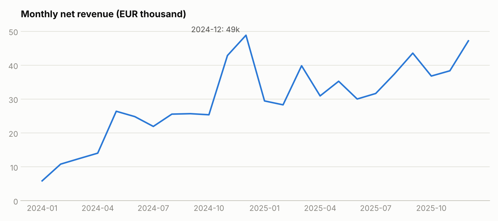
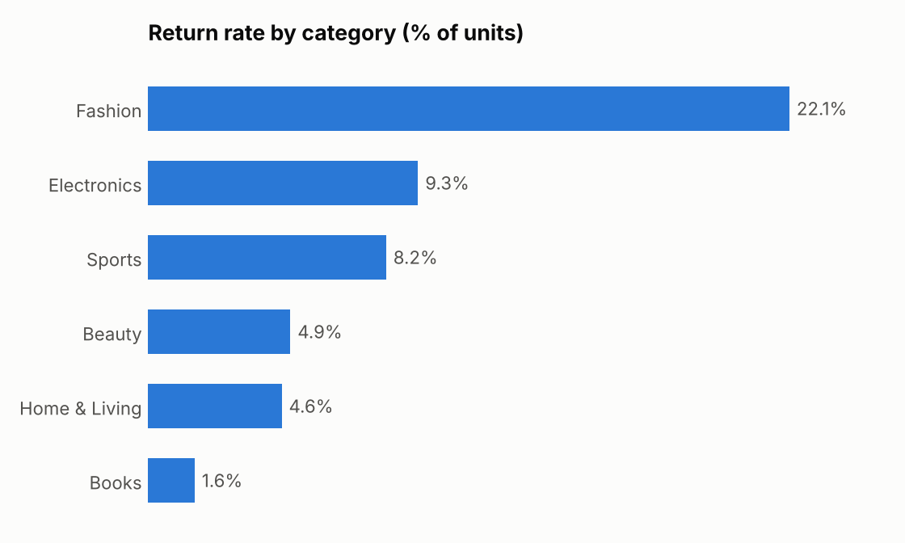
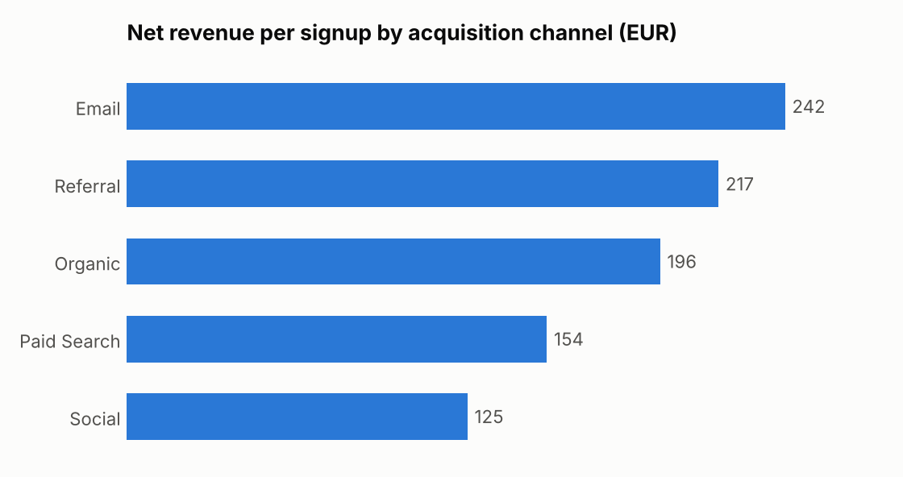
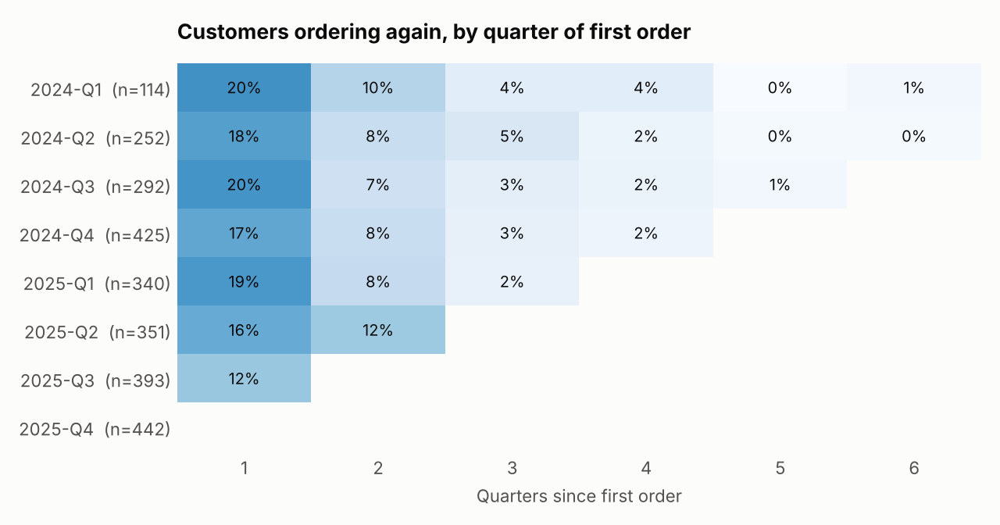
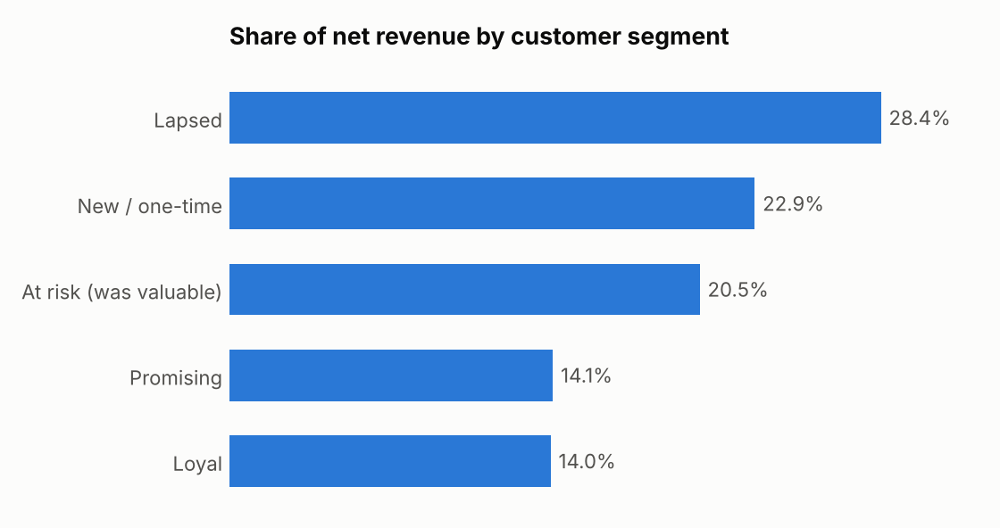

# Retail Sales Analysis with SQL

A business analysis of a fictional German online retailer, written in SQL
(SQLite) with a small Python script that builds the database, runs the queries
and draws the charts.

The project answers six questions a management team would ask:

| # | Question | SQL techniques | File |
|---|----------|----------------|------|
| 1 | How is revenue developing month by month? | CTE, `LAG()` for MoM and YoY growth | [`01_monthly_revenue.sql`](01_monthly_revenue.sql) |
| 2 | Which categories sell, and which get returned? | Conditional aggregation, share of total | [`02_category_performance.sql`](02_category_performance.sql) |
| 3 | Which acquisition channels bring the best customers? | `LEFT JOIN`, per-customer roll-up | [`03_channel_performance.sql`](03_channel_performance.sql) |
| 4 | Do customers come back? | Cohort analysis, `FIRST_VALUE()` | [`04_cohort_retention.sql`](04_cohort_retention.sql) |
| 5 | Which customer segments should marketing focus on? | RFM scoring with `NTILE()`, `CASE` | [`05_rfm_segments.sql`](05_rfm_segments.sql) |
| 6 | How dependent is the business on its top customers? | Deciles, running total | [`06_revenue_concentration.sql`](06_revenue_concentration.sql) |

## About the data

**The data is synthetic.** It is created by
[`generate_data.py`](generate_data.py) with a fixed random seed, so
the same files are produced on every run. The patterns described below
(seasonality, return rates, channel differences) are built into the generator.
The purpose of the project is to show the analysis method, not to report
findings about a real company.

Four tables, 2024-01-01 to 2025-12-31:

| Table | Rows | Content |
|-------|------|---------|
| `customers` | 4,000 | signup date, city, acquisition channel |
| `products` | 48 | name, category, list price |
| `orders` | 4,038 | customer, date, status (completed / cancelled) |
| `order_items` | 7,110 | product, quantity, price, discount, returned flag |

**Net revenue** throughout means: completed orders, after discounts, excluding
returned items. It is defined once in the `order_revenue` view in
[`00_schema.sql`](00_schema.sql) and reused by the queries.

## Results

Net revenue was EUR 713k over the two years: EUR 285k in 2024 and EUR 429k in
2025 (+51 %).

**1. Revenue peaks in November and December.** December 2024 was the strongest
month (EUR 49k). November and December 2025 were slightly below the same months
of 2024 (-10.5 % and -3.4 %), after year-over-year growth in every earlier month.



**2. Fashion has a return problem.** 22.1 % of Fashion units are returned,
against 1.6 % to 9.3 % in the other categories. Returns reduce Fashion revenue
from EUR 152k to EUR 119k. Electronics brings 52 % of net revenue from only
12 % of units, so the business depends heavily on one category.



**3. Email and Referral customers are worth about twice as much as Social
customers.** Net revenue per signup is EUR 242 for Email and EUR 217 for
Referral, against EUR 125 for Social. The difference comes from both conversion
(74 % vs 54 % of signups ever buy) and repeat purchases (42 % vs 19 % of buyers
order more than once).



**4. Most customers do not come back.** Between 12 % and 20 % of a cohort
orders again in the following quarter, and under 5 % are still active after
three quarters.



**5. A small "at risk" group holds a fifth of revenue.** 272 customers (10 % of
buyers) ordered several times and spent well, but have not ordered for over a
year on average. They account for 20.5 % of net revenue and are the obvious
target for a win-back campaign.



**6. Revenue is concentrated.** The top 10 % of buyers generate 37.7 % of net
revenue, and the top 20 % generate 58 %.

Each query has a result table saved as a CSV file with the same name, for example `01_monthly_revenue.csv`.

## How to run it

Requires Python 3.9 or newer.

```bash
pip install -r requirements.txt
python generate_data.py   # optional: the CSV files are already in the repo
python run_analysis.py
```

`run_analysis.py` creates `retail.db`, runs the six `.sql` queries in order,
prints each result, and writes the result tables (CSV) and charts (PNG).

To explore the database yourself, open `retail.db` in
[DB Browser for SQLite](https://sqlitebrowser.org/) or run `sqlite3 retail.db`.

## Files

| Files | Content |
|-------|---------|
| `00_schema.sql` | tables, indexes and the `order_revenue` view |
| `01_…sql` to `06_…sql` | the six analysis queries |
| `01_…csv` to `06_…csv` | the result table of each query |
| `customers.csv`, `products.csv`, `orders.csv`, `order_items.csv` | the data |
| `generate_data.py` | creates the data |
| `run_analysis.py` | builds the database, runs the queries, draws the charts |
| `*.png` | charts |

## Limitations and next steps

- The data is synthetic, so the numbers only illustrate the method.
- Returns are recorded without a date, so they are counted in the month of the
  order, not the month of the return.
- Next step: run the same queries on a real public dataset such as the
  Olist Brazilian e-commerce data, and compare.
